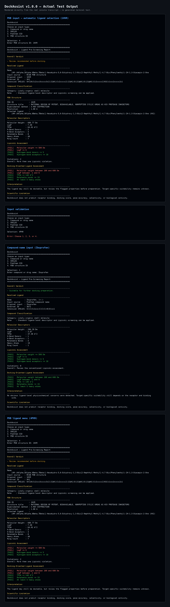
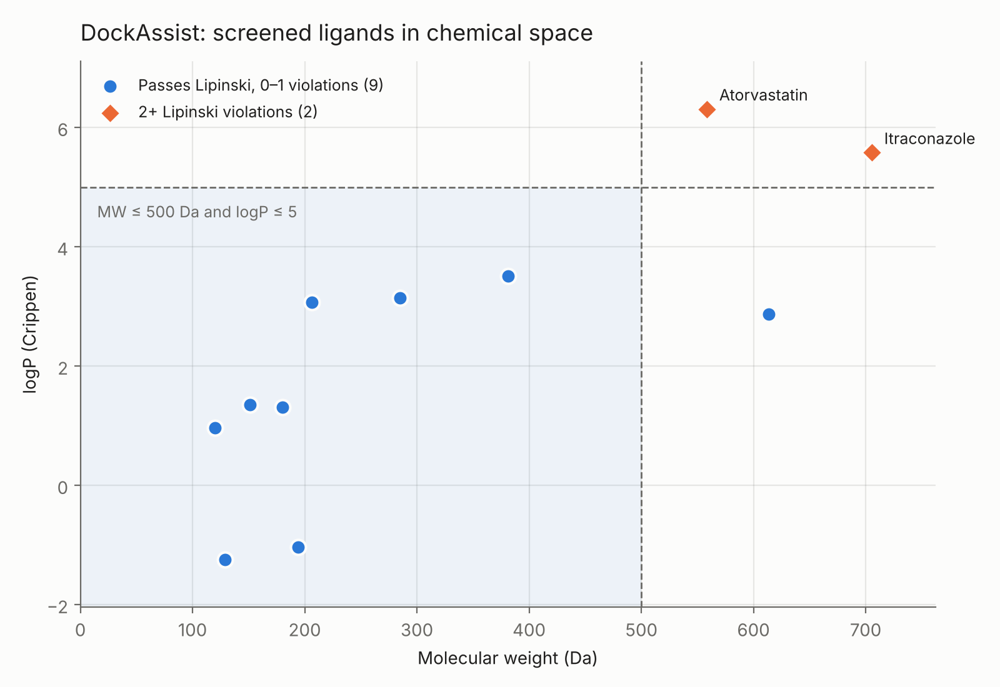

# DockAssist

DockAssist is a Python command-line tool for pre-screening small-molecule ligands before molecular docking. It supports compound names, SMILES, PubChem CIDs and PDB structure IDs, calculates molecular descriptors using RDKit, evaluates Lipinski's Rule of Five, and provides a ligand-level assessment. It can screen one ligand at a time or a whole CSV of ligands, and plots batches in chemical space..



## Features

- Compound name, SMILES, PubChem CID and PDB structure ID input
- Automatic ligand retrieval from PubChem and the RCSB Protein Data Bank
- Molecular descriptor calculation
- Lipinski's Rule of Five assessment
- Docking-oriented physicochemical screening
- PDB structure metadata retrieval
- Human-readable terminal reports
- Batch screening of a CSV of ligands, with data cleaning:
  - failed lookups and invalid SMILES are logged instead of crashing the run
  - duplicates are removed by canonical SMILES
  - results table, error log and summary statistics are saved
- Chemical-space plot (molecular weight vs logP) with the Lipinski region marked

## Installation

```bash
pip install -r requirements.txt
```

## Usage

```bash
python DockAssist.py
```

Choose an input type:

```text
1. Compound or drug name
2. SMILES
3. PubChem CID
4. PDB structure ID
5. Batch screen a CSV file (with chemical-space plot)
```

Option 5 asks for a CSV file; press Enter to use the included `example_ligands.csv`. The plot opens automatically and is saved, with the results table, to a `results/` folder.

To run a batch directly:

```bash
python DockAssist.py --batch example_ligands.csv --out results
```

### Batch CSV format

| Column | Required | Meaning |
|---|---|---|
| `input` | yes | Compound name, SMILES or PubChem CID |
| `type` | no | `name`, `smiles` or `cid` (guessed if blank) |
| `name` | no | Label used in the results table and plot |

## Example batch result



In the example set, atorvastatin and itraconazole both fail two of Lipinski's rules, yet both are approved oral drugs. The rules are useful for prioritising compounds, not for ruling them out.

## Origin

DockAssist was developed following my undergraduate dissertation:

**Docking Reproducibility: Vina, Smina and GOLD Compared**

The project was created to streamline ligand pre-screening tasks commonly performed before molecular docking.

DockAssist was created to make computational chemistry more accessible. During my studies, I found that many tools and tutorials assumed prior knowledge and were difficult for beginners to approach. DockAssist aims to bridge that gap by providing clear, visual, and educational ligand pre-screening without paywalls or unnecessary complexity.

📄 Dissertation:
https://github.com/benjaminkamya/Undergraduate-Dissertation 

## Technologies

- Python
- RDKit
- pandas
- Matplotlib
- PubChem
- RCSB Protein Data Bank

## Scientific Limitations

DockAssist is a ligand pre-screening tool. It does **not** perform molecular docking or predict binding affinity, docking scores, binding poses, selectivity, or biological activity.

## License

Released under the MIT License.
